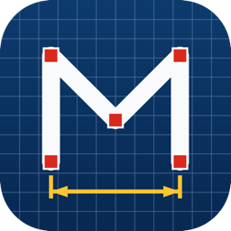
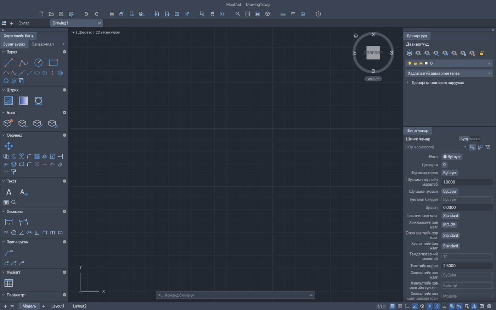
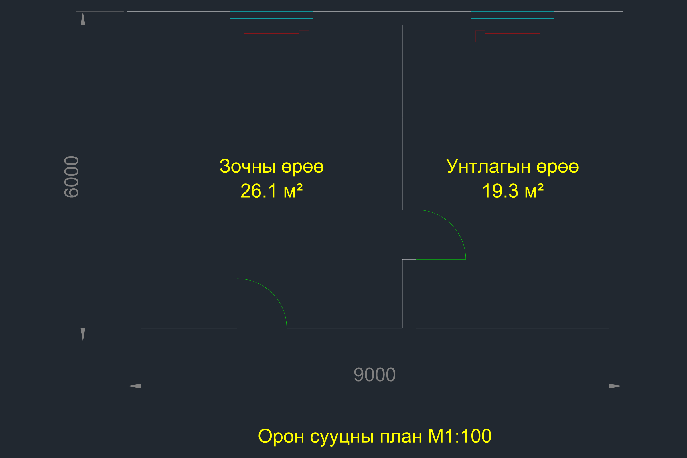

<p align="center">
  
</p>

<h1 align="center">MonCad</h1>

<p align="center">
  <b>Монгол инженерүүдэд зориулсан үнэгүй, нээлттэй эхийн CAD програм.</b><br>
  Гараар зурна — эсвэл Claude, ChatGPT-ээр шууд CAD зураг зуруулна.
</p>

<p align="center">
  <a href="docs/moncad/INSTALL-mn.md">Суулгах</a> ·
  <a href="docs/moncad/AI-mn.md">AI-аар зуруулах</a> ·
  <a href="#english">English</a> ·
  <a href="https://cad.monhydro.com">Сургалт</a>
</p>

---

## MonCad гэж юу вэ?

MonCad бол AutoCAD-тай төстэй 2D CAD програм: командын мөр (`LINE`, `CIRCLE`, `TRIM`, `OFFSET`…),
объектын барилт, давхарга, хэмжээс, штрих, блок, DXF зураг — таны мэддэг бүхэн. Pure Rust дээр
бичигдсэн тул хурдан, жижиг, Windows болон macOS дээр ажиллана.

| | |
|---|---|
| **Хэл** | Монгол (бүрэн орчуулга, 2,053 мөр) ба англи, програм дахин асаалгүй солино. Бусад 19 хэл ч бий. |
| **Монгол гар** | Гарын байрлал Монгол үед ч команд ажиллана: «лшиу» = `LINE`, «ёшжёлу» = `CIRCLE` |
| **Нэгж** | Шинэ зураг анхнаасаа метр систем (мм), ISO-25 хэмжээсийн хэв маягтай |
| **AI** | MCP сервертэй: Claude Code, Claude Desktop, ChatGPT desktop, Codex — зурах, шалгах, PNG харах, DXF/PDF хадгалах |
| **Файл** | DXF R12–2018 найдвартай; DWG туршилтын (алдагдал байвал анхааруулна); PDF, SVG, PNG экспорт |
| **Үнэ** | Үнэгүй, нээлттэй эх (MIT OR Apache-2.0) |

<p align="center">
  
</p>

## AI-аар зуруулах — 1 минутад

```bash
claude mcp add moncad -- moncad-cli mcp --connect 127.0.0.1:7979 --launch
```

Дараа нь Claude-д: *«MonCad дээр 6×9 м хэмжээтэй 2 өрөөтэй байрны план зур, хананы зузаан 250 мм,
хаалга цонхтой, хэмжээс тавь.»* MonCad өөрөө нээгдэж, AI таны нүдэн дээр зурна.
ChatGPT desktop болон бусад програмын тохиргоо: [docs/moncad/AI-mn.md](docs/moncad/AI-mn.md).

Жишээ: Claude Code MCP-ээр 1 удаагийн даалгавраар зурсан план ([даалгавар](docs/moncad/demo/prompt.txt),
[DXF](docs/moncad/demo/plan-demo.dxf)):

<p align="center">
  
</p>

## Эх кодоос build хийх

```bash
cargo run --release -p cadcraft              # MonCad програм (binary: moncad)
cargo build --release -p cadcraft-cli        # moncad-cli (MCP сервер, хөрвүүлэгч)
packaging/moncad/build-windows.sh            # macOS/Linux дээрээс Windows суулгагч
```

Rust 1.95+ шаардлагатай. Дэлгэрэнгүй: [docs/moncad/FORK.md](docs/moncad/FORK.md).

## Эх сурвалж ба лиценз

MonCad нь ArtCraft баг ба нийгэмлэгийн бүтээсэн [CADCraft](https://github.com/storytold/cadcraft)
дээр суурилсан бөгөөд адил **MIT OR Apache-2.0** лицензтэй ([LICENSE-MIT](LICENSE-MIT),
[LICENSE-APACHE](LICENSE-APACHE), [NOTICE](NOTICE)). MonCad бол ArtCraft-ийн бүтээгдэхүүн биш.
AutoCAD ба DWG нь Autodesk, Inc.-ийн барааны тэмдэг; MonCad нь Autodesk-тай холбоогүй.

---

<a id="english"></a>
## English

**MonCad** is a free, open-source 2D CAD application for Mongolian engineers, based on
[CADCraft](https://github.com/storytold/cadcraft) by the ArtCraft team and community. Draw by hand
with the familiar AutoCAD-style command line, or let Claude or ChatGPT draw for you over MCP.

What MonCad adds to CADCraft:

- a complete **Mongolian (Cyrillic)** interface (`mn`, 2,053 rows, nothing falls back to English), live switching with English;
- commands typed with the **Mongolian keyboard layout** are understood (`лшиу` = LINE);
- **metric by default** (millimetres, ISO-25), also in the headless MCP session;
- `moncad-cli mcp --launch` opens the app on **Windows** and Linux too, not only macOS;
- a per-user **Windows installer** (Mongolian/English) with a "MonCad (AI)" Start menu entry and ready-to-paste AI connection commands;
- its own name, icon, settings folder and update channel, so it never collides with an installed CADCraft.

Docs: [install (mn)](docs/moncad/INSTALL-mn.md) · [AI control (mn)](docs/moncad/AI-mn.md) ·
[fork notes](docs/moncad/FORK.md) · [Mongolian glossary](docs/moncad/mn-glossary.md) ·
[upstream CADCraft README](docs/upstream/CADCraft-README.md) · [MCP reference](docs/mcp.md) ·
[CLI](docs/cli.md) · [localization](docs/localization.md)

License: MIT OR Apache-2.0, like CADCraft. MonCad is not affiliated with or endorsed by the
ArtCraft Team or Autodesk, Inc.
